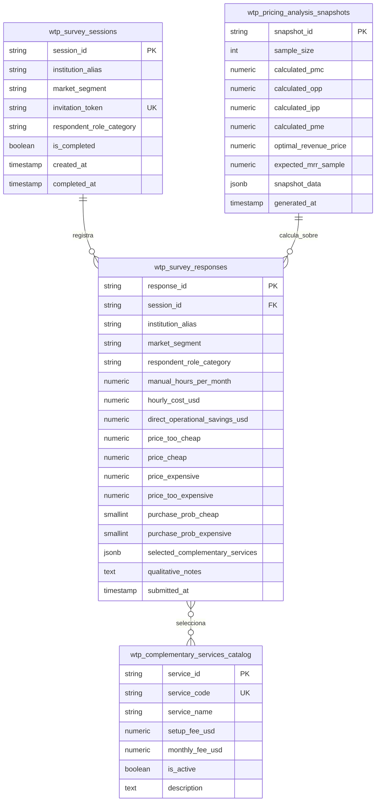

# Especificación Técnica y Metodológica: Aplicación Dedicada WTP (Sensibilidad de Precios)

> [!NOTE]
> Documento de diseño metodológico original (v2.0). Para la arquitectura vigente de producción en contenedores (**FastAPI + PostgreSQL 16**, rutas separadas `/` y `/admin` con autenticación por cookie `HttpOnly` y catálogo dinámico), consultar [`../README.md`](../README.md) y [`DEPLOY_AWS.md`](./DEPLOY_AWS.md).

**Proyecto:** Latinex Data Hub: Etapa 2 (IE-PRY-002)  
**Entregable Asociado:** D1.1: Fundamentos de Producto y Metodología de Pricing  
**Módulo:** WTP Standalone Application  
**Versión:** 2.0  
**Fecha de Actualización:** 2026-11-09  

---

## 1. Naturaleza y Aislamiento del Sistema (Standalone Architecture)

La aplicación web WTP (*Willingness to Pay*) es una herramienta independiente y desacoplada del sitio público y de la base de datos central (`cm-db`). Su propósito es capturar de forma confidencial y estructurada la sensibilidad tarifaria de los decisores institucionales del mercado panameño (puestos de bolsa, bancos comerciales, administradores de fondos y custodios).

### Principios de Diseño del Sistema:
1. **Desacoplamiento Operativo:** Funciona como un módulo autónomo con su propio esquema relacional (`database/schema.sql`) para persistir sesiones y respuestas sin interferir con la infraestructura transaccional de producción.
2. **Presentación de la Solución Integral:** Las capacidades del servicio oficial (los 8 endpoints OpenAPI y las 5 funciones de la Consola Corporativa) se presentan en el flujo de la encuesta como el **estímulo de valor** para que el evaluador aprecie la solución completa antes de indicar sus umbrales monetarios.
3. **Cero Sesgo de Anclaje Numérico:** No se presentan cifras sugeridas ni comparativas de precios bajos vs. altos en las secciones explicativas. Se apela a la consciencia institucional de co-inversión en una infraestructura de datos sostenible y de alto estándar técnico.
4. **Validación Estricta en Tiempo Real:** Garantiza la coherencia matemática de las respuestas ($P_{\text{MB}} < P_{\text{B}} < P_{\text{C}} < P_{\text{MC}}$) impidiendo inconsistencias lógicas en la base de datos.
5. **Confidencialidad y Neutralidad:** Cero nombres comerciales o de personas quemados en la interfaz o maquetas. Toda referencia visual utiliza marcadores genéricos (`[Nombre de su Institución]`, `Entidad Institucional #01`).
6. **Integridad de Estilo:** Prohibición estricta de caracteres de raya em (`:`), utilizando `:` o `,` según corresponda.

---

## 2. Esquema de Base de Datos Dedicada

La aplicación almacena las evaluaciones en un motor relacional independiente (compatible con **PostgreSQL 14+** y **SQLite 3**).



### Regla de Integridad Estricta en Base de Datos:
```sql
CONSTRAINT chk_strict_price_inequality CHECK (
    price_too_cheap > 0 AND
    price_too_cheap < price_cheap AND
    price_cheap < price_expensive AND
    price_expensive < price_too_expensive
);
```

---

## 3. Especificación Funcional del Wizard en 5 Pasos

### Paso 1: Introducción y Contexto Institucional
- **Objetivo:** Establecer el contexto estratégico de modernización del mercado de valores de Panamá y la corresponsabilidad en la sostenibilidad técnica del servicio.
- **Enfoque de Negocio:**
  - Se explica que Latinex opera como infraestructura tecnológica del mercado financiero local.
  - Se subraya la relación directa entre la sostenibilidad económica de la tarifa y la capacidad de la bolsa para ofrecer a las propias instituciones miembros soporte técnico ágil, alta disponibilidad (SLA 99.8%), ciberseguridad continua y desarrollo de nuevos datasets.
  - **Neutralidad absoluta:** No se mencionan precios, rangos numéricos ni niveles de servicio estratificados por costo en este paso para evitar el sesgo de anclaje cognitivo.
- **Acción:** Botón de avance hacia el Paso 2 (*Comenzar Evaluación: Perfil Institucional →*).

### Paso 2: Perfil Institucional y Cuantificación de Esfuerzo Operativo
- **Campos Capturados:**
  - Institución Financiera: Campo de texto con marcador genérico `[Nombre de su Institución / Puesto de Bolsa]`.
  - Contacto / Evaluador: Campo de texto genérico `[Nombre o Cargo del Evaluador]`.
  - Segmento del Mercado: Selector con opciones estándar del mercado local (`Puesto de Bolsa / Casa de Valores`, `Banco / Puesto de Bolsa Integrado`, `Banco Comercial / Tesorería`, `Wealth Management / Gestor de Inversiones`, `Proveedor Financiero / Calificadora / Otro`).
  - Rol del Tomador de Decisión: `Decisor Comercial, Mesa de Dinero o Dirección` / `Decisor Técnico, TI, Operaciones o Riesgos`.
  - Horas-Hombre Mensuales Manuales: Input numérico editable dedicado a descarga y carga manual de **Información de Mercado** (valor por defecto: `46` horas/mes).
  - Costo Hora Estimado de Personal (USD / hr): Input numérico editable por el usuario (valor por defecto: `$25.00` USD/hr).
- **Cálculo de Ahorro Operativo Directo:**
  - Fórmula pura y transparente:
    $$\text{Ahorro Mensual Directo} = \text{Horas Mensuales} \times \text{Costo por Hora}$$
  - Para los valores base ($46 \text{ hrs} \times \$25/\text{hr}$), el ahorro operativo directo asciende a **~$1,150.00 USD / mes**.
  - Se eliminó cualquier concepto accesorio o recargo abstracto (como mitigación de riesgo operacional) para mantener total claridad ejecutiva.

### Paso 3: Solución Integral y Alcance del Servicio
- **Objetivo:** Presentar al evaluador la totalidad de las capacidades que su entidad recibe dentro de la suscripción antes de consultar los precios.
- **Contenido del Paquete:**
  1. **Los 8 Endpoints Oficiales OpenAPI:** Verificados contra el Swagger UI productivo (`https://api.latinexhub.com/v1/api-docs`):
     - `GET /v1/trades`: Cinta de transacciones ejecutadas (paginada por cursor) para conciliación de boletas.
     - `GET /v1/prices`: Histórico de precios oficiales de cierre para valoración de carteras (Mark-to-Market).
     - `GET /v1/market/offers`: Libro de posturas vigentes por nivel de profundidad para mesas de dinero.
     - `GET /v1/instruments`: Catálogo maestro de títulos valores registrados en el mercado local.
     - `GET /v1/instruments/{symbol}/payment-plan`: Cronograma proyectado de cupones, amortizaciones y tasas faciales.
     - `GET /v1/instruments/search`: Buscador multicriterio de instrumentos por emisor, cupón y plazo.
     - `GET /v1/discovery`: Catálogo general de colecciones y servicios disponibles.
     - `GET /v1/datasets/availability`: Cobertura histórica y disponibilidad temporal de series bursátiles.
  2. **Capacidades de la Consola Corporativa:**
     - Autogestión segura de credenciales M2M con rotación de claves.
     - Métricas y monitoreo de consumo en tiempo real.
     - Entorno Sandbox interactivo para pruebas de integración.
     - Recetas de código y ejemplos de conexión.
     - Gestión corporativa de usuarios y perfiles organizacionales.
- **Validación de Lectura:** Checkbox obligatorio de confirmación (*«He revisado el alcance de la solución y las capacidades corporativas incluidas para considerarlas al evaluar los umbrales de precio»*).

### Paso 4: Umbrales de Sensibilidad de Precios
- **Estructura de Preguntas:** Se consulta la percepción tarifaria mensual en USD/mes para la suscripción de la entidad:
  1. **Precio MUY BARATO:** ¿A qué tarifa mensual consideraría que el servicio es tan bajo que dudaría de su calidad, soporte técnico o respaldo institucional?
  2. **Precio BARATO / BUENA OFERTA:** ¿A qué tarifa mensual consideraría que es una excelente inversión por el ahorro y valor que genera?
  3. **Precio CARO:** ¿A qué tarifa mensual comenzaría a parecerle elevado, aunque aún justificaría evaluarlo por el beneficio operativo?
  4. **Precio MUY CARO:** ¿A qué tarifa mensual descartaría completamente la contratación por exceder su presupuesto?
- **Valores Iniciales por Defecto:**
  $$\$450 < \$750 < \$900 < \$1,500 \text{ USD/mes}$$
- **Validación en Vivo:** Retroalimentación inmediata con banner verde ante coherencia estricta, o alerta roja con bloqueo de avance si se detecta cualquier cruce o igualdad entre umbrales.

### Paso 5: Probabilidad de Compra y Servicios Adicionales
- **Medición de Intención de Compra (Horizonte 90 días):**
  - Pregunta A: Probabilidad de contratación si la tarifa oficial fuera su precio **BARATO** declarado (escala Likert 1 a 5).
  - Pregunta B: Probabilidad de contratación si la tarifa oficial fuera su precio **CARO** declarado (escala Likert 1 a 5).
  - Calibración estadística: Se aplican los pesos empíricos de calibración de demanda B2B:
    $$\text{Likert: } [1 \rightarrow 0.0, \; 2 \rightarrow 0.1, \; 3 \rightarrow 0.3, \; 4 \rightarrow 0.5, \; 5 \rightarrow 0.7]$$
- **Servicios Adicionales Opcionales (Facturación Adicional a la Suscripción):**
  - Se explicita con claridad: *«Los siguientes servicios son complementarios y se facturan de forma adicional a la suscripción mensual de datos»*.
  - Catálogo de 3 servicios:
    1. **Conector Automatizado AWS S3 para Hechos Relevantes:** Repositorio cloud dedicado para entrega continua de documentos oficiales (Setup: $500 USD + $100 USD/mes).
    2. **Tablero Interactivo con Marca Institucional:** Visualizador web personalizado con buscador y filtros de renta fija para asesores y mesas (Setup: $1,800 USD + $250 USD/mes).
    3. **Cliente Programático (API Client / SDK Institucional):** Componente empaquetado para el equipo de TI de la entidad con gestión de autenticación M2M y control de tokens (Setup: $900 USD + $100 USD/mes).

---

## 4. Consola de Inteligencia Tarifaria (Super Admin)

### 4.1. Indicadores Clave de Sensibilidad (KPIs Calculados)
- **Límite Inferior Aceptable (PMC - Punto Marginal de Baratura):** Intersección donde el porcentaje acumulado de evaluadores que considera el servicio "Muy Barato" iguala a quienes lo consideran "Caro". Por debajo de este nivel, la tarifa genera dudas sobre el soporte y estabilidad.
- **Precio de Mínima Resistencia (OPP - Punto de Precio Óptimo):** Intersección de las curvas "Muy Barato" y "Muy Caro". Representa el punto donde el rechazo combinado del mercado es mínimo.
- **Punto Medio del Mercado (IPP - Punto de Precio de Indiferencia):** Intersección de las curvas "Barato" y "Caro". Representa la mediana de equilibrio percibida.
- **Límite Superior Aceptable (PME - Punto Marginal de Carestía):** Intersección donde quienes consideran el servicio "Muy Caro" igualan a quienes lo consideran "Barato". Por encima de este valor, la mayoría descarta la contratación.
- **Rango Aceptable de Precios (RAP):** Intervalo $[\text{PMC}, \text{PME}]$. En la muestra base: $[\$525, \$1,100]$.

### 4.2. Proyección de Ingresos Mensuales Esperados
Para cada precio $p$ en una malla de evaluación:
$$\text{MRR Esperado}(p) = p \times \sum_{i=1}^{N} \text{Probabilidad de Adopción}_i(p)$$
Donde la probabilidad individual interpola los pesos asignados en los precios Barato y Caro dentro del rango aceptable.
- En la muestra base de 12 entidades institucionales, el precio que maximiza la recaudación mensual esperada se sitúa en **$775 USD / mes**, generando un ingreso proyectado de **$4,690 USD / mes** (~$111,600 USD anuales considerando adopción probabilística sobre la muestra).

### 4.3. Matriz de Auditoría Confidencial
Presenta el desglose anonimizado de las 12 entidades evaluadas, reflejando:
- Identificador neutral (`Entidad Institucional #01` a `#12`).
- Rol del evaluador y segmento de mercado.
- Los 4 umbrales de sensibilidad ($P_{\text{MB}}, P_{\text{B}}, P_{\text{C}}, P_{\text{MC}}$).
- Vector de probabilidad declarada (Barato / Caro).
- Estado de interés en cada uno de los 3 servicios complementarios (`Conector S3`, `Tablero Marca`, `API Client SDK`).
